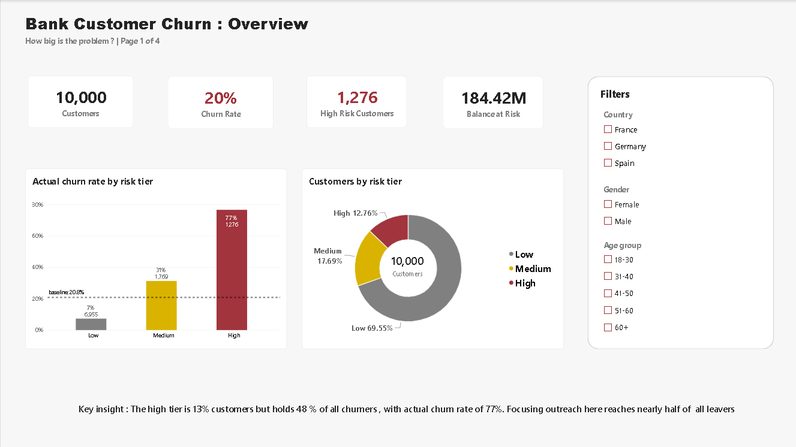
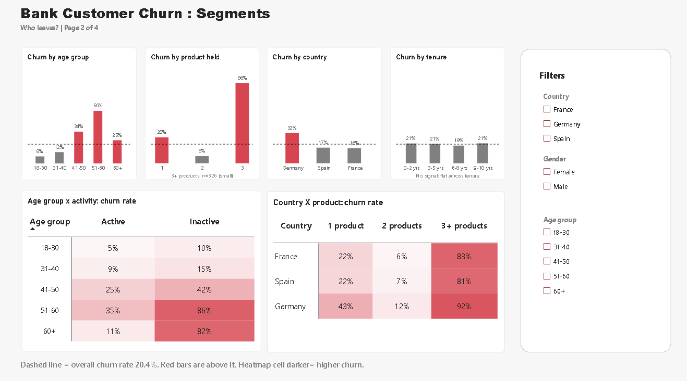
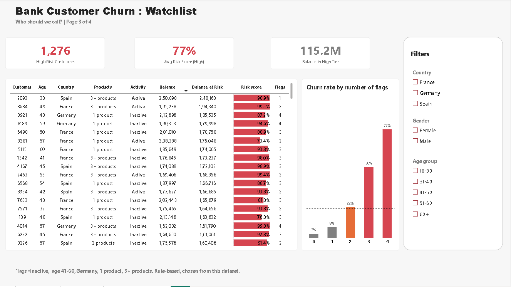
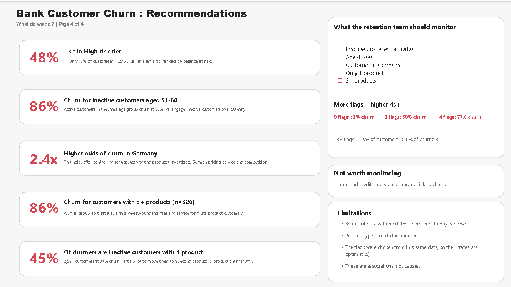

# Bank Customer Churn Analysis

**Python + Power BI** | Which customer segments carry the highest churn risk, and what should the retention team monitor?



## 1. Summary

A bank loses about **1 in 5 customers (20.4%)**. This project finds who is most at risk, checks that the patterns are real, scores every customer by risk, and turns the result into a dashboard a retention team can use.

**Headline findings**

- The **High-risk tier is 13% of customers but holds 48% of all churners** (actual churn rate 77%).
- **Age 41-60** is 31% of customers but **61% of churners**. Inactive customers aged 51-60 churn at **86%**.
- **Germany** churns at 32% (France 16%, Spain 17%). The effect holds after controlling for age, activity and products (odds ratio 2.4).
- **Customers with 3+ products churn at 86%** (small group, n=326). Customers with 2 products are the safest at 8%.
- **Inactive customers with 1 product** are 25% of the base and **45% of churners**.
- **Tenure and credit card status show no link to churn.**
- A simple five-flag checklist separates risk well: **0 flags = 3% churn, 3 flags = 50%, 4 flags = 77%**.

## 2. Business question

> Which customer segments carry the highest churn risk, and which attributes should the retention team monitor as early-warning flags?

The original brief asked for signals "30 days before churning". The data is a single snapshot with no dates, so a true 30-day window is not possible. The question is reframed as above, and this limit is stated again in Section 8.

## 3. Data

- **Source:** public Kaggle bank customer churn dataset (10,000 customers, 12 columns, no missing values, no duplicates).
- **Target:** `churn` (1 = left, 0 = stayed). Overall rate: 20.37%.
- **Columns used:** credit score, country, gender, age, tenure, balance, number of products, credit card, active member, estimated salary.
- **Note:** the dataset does not say what the "products" are, and it may be partly synthetic. `customer_id` is a row identifier, not a real account.

## 4. Method

| Stage | What I did | Tool |
|---|---|---|
| 1. Define | Churn definition, baseline rate, business question | - |
| 2. Prepare | Checked quality, created age, tenure, balance and product bands, readable labels | Python (pandas) |
| 3. Single segments | Churn rate, gap vs baseline and share of churners for each cut | Python |
| 4. Combinations | Two-way and three-way cuts, ranked by rate and size | Python |
| 5. Validate | Chi-square tests with Holm correction, confidence intervals, Mantel-Haenszel test for Germany, interaction test for age and activity | Python (scipy, statsmodels) |
| 6. Score | Logistic regression and gradient boosting, out-of-fold risk scores, risk tiers, permutation importance | Python (scikit-learn) |
| 7. Dashboard | Four-page report with slicers and DAX measures | Power BI |

## 5. Key results

### Churn by segment (baseline 20.4%)

| Segment | Customers | Churn rate | Share of all churners |
|---|---|---|---|
| Age 51-60 | 797 | 56.2% | 22.0% |
| Age 41-60 | 3,117 | 39.7% | 60.7% |
| Germany | 2,509 | 32.4% | 40.0% |
| Inactive members | 4,849 | 26.9% | 63.9% |
| 1 product + inactive | 2,521 | 36.7% | 45.4% |
| 3+ products | 326 | 85.9% | 13.7% |
| Tenure (any band) | - | 19-21% | no signal |

### Validation

- Age, product count, country, activity, balance and gender are each significantly linked to churn (chi-square, Holm-adjusted). **Tenure (p = 0.20) and credit card (p = 0.49) are not.**
- **Germany** stays a risk factor after controlling for age, activity and products: adjusted odds ratio **2.41** (95% CI 2.13 to 2.74).
- **Inactivity matters more for older customers** (interaction test, p < 0.001): 86% churn for inactive customers aged 51-60 vs 10% for inactive customers aged 18-30.

### Risk model

| Model | ROC-AUC (held-out test) | PR-AUC |
|---|---|---|
| Logistic regression | 0.847 | 0.645 |
| **Gradient boosting** | **0.878** | **0.729** |

Out-of-fold ROC-AUC across all customers: 0.867. Because 80% of customers stay, accuracy is misleading, so I report precision, recall and AUC. At a 0.50 alert threshold the model flags 12.9% of customers with 77% precision and 49% recall.

| Risk tier | Customers | Actual churn rate | Share of all churners |
|---|---|---|---|
| Low (< 20%) | 6,955 | 7.3% | 24.9% |
| Medium (20-50%) | 1,769 | 31.3% | 27.1% |
| **High (> 50%)** | **1,276** | **76.6%** | **48.0%** |

Most important drivers (permutation importance): age, having only 1 product, having 3+ products, balance, inactive status, Germany. Tenure, credit card and salary add almost nothing.

### Early-warning checklist

Five rule-based flags: inactive, age 41-60, Germany, only 1 product, 3+ products.

| Flags | Customers | Churn rate |
|---|---|---|
| 0 | 1,381 | 2.8% |
| 1 | 3,573 | 7.6% |
| 2 | 3,188 | 21.7% |
| 3 | 1,496 | 50.5% |
| 4 | 362 | 77.3% |

Customers with 3 or more flags are 18.6% of the base and 50.8% of churners.

## 6. Dashboard

| Page | Question | Contents |
|---|---|---|
| 1. Overview | How big is the problem? | KPI cards, churn by risk tier, customers by tier, slicers, dynamic key insight |
| 2. Segments | Who leaves? | Churn by age, products, country and tenure; age x activity and country x products heatmaps |
| 3. Watchlist | Who should we call? | High-risk customer table ranked by balance at risk, churn rate by flag count |
| 4. Recommendations | What do we do? | Five findings with actions, monitoring checklist, limitations |

### 1. Overview


### 2. Segments


### 3. Watchlist


### 4. Recommendations


## 7. Recommendations

1. **Call the High-risk tier first**, ranked by balance at risk (balance x churn probability).
2. **Re-engage inactive customers over 50** before they leave.
3. **Investigate the German market** (pricing, service, competition). The data shows the gap but not the cause.
4. **Review fees and bundling for customers with 3+ products.** Treat as a flag, since the group is small.
5. **Pilot a second-product offer** for inactive single-product customers, and measure the effect before scaling.
6. **Do not spend effort monitoring tenure or credit card status.**

## 8. Limitations

- **Snapshot data, no dates.** The 30-day early-warning window cannot be tested. A real system needs monthly activity history.
- **Product types are not documented.** The analysis treats the product count as how deeply a customer uses the bank.
- **The flag rates are optimistic.** I chose the flags and thresholds from the same data. Validating on held-out data would give lower, fairer rates.
- **Associations, not causes.** The analysis shows who churns, not why, so recommendations are hypotheses to test.
- **Small groups.** 3+ products has only 326 customers, so its exact rate is uncertain.
- **The data may be partly synthetic**, and real results could differ.
- **Risk tier cut-offs are my choice**, set for readability. A bank would set them from its retention budget.
- **Balance at Risk understates risk for zero-balance customers**, who are 36% of the base.

## 9. Repository structure

```
bank-churn-analysis/
├── data/
│   ├── Bank_Customer_Churn_Prediction.csv   (raw)
│   └── churn_powerbi.csv                    (scored, used by Power BI)
├── notebooks/ or scripts/
│   ├── stage2_data_prep.py
│   ├── stage3_single_segments.py
│   ├── stage4_combinations.py
│   ├── stage5_validation.py
│   └── stage6_risk_model.py
├── dashboard/
│   └── churn_dashboard.pbix
├── images/                                  (dashboard screenshots)
└── README.md
```

## 10. How to reproduce

```bash
pip install pandas numpy scipy statsmodels scikit-learn matplotlib
python scripts/stage2_data_prep.py      # writes churn_clean.csv
python scripts/stage3_single_segments.py
python scripts/stage4_combinations.py
python scripts/stage5_validation.py
python scripts/stage6_risk_model.py     # writes churn_scored.csv
```

Open `dashboard/churn_dashboard.pbix` in Power BI Desktop and refresh the data source path to `data/churn_powerbi.csv`.

## 11. What I would do next

- Use a dataset with dated activity to test the real 30-day window.
- Validate the flags on held-out data.
- Add a cost-benefit view: the cost of a retention offer against the balance saved.

---

---

## Author

**Arjun Pamula**  
B.Tech – Metallurgical and Materials Engineering  
National Institute of Technology, Warangal

[LinkedIn](https://www.linkedin.com/in/arjun-p-1b74a4359/) | [Email](mailto:pamulaarjun2004@gmail.com)

